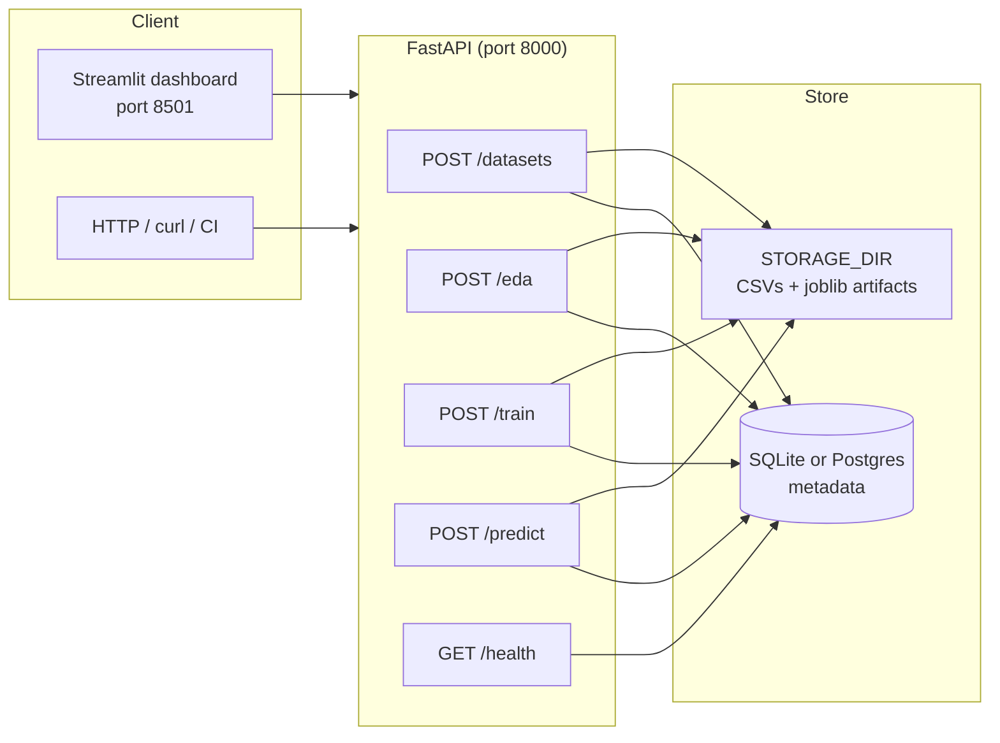

# InsightForge

**Upload a CSV, get an exploratory report, train a baseline model, and score new rows — from a small API and a Streamlit dashboard.**

[](https://github.com/Faridkosarifard/insightforge/actions/workflows/ci.yml)


InsightForge is a local-first tool for a first pass at a tabular dataset. You upload a CSV, inspect column types, missing values, descriptives and correlations, fit a scikit-learn Random Forest baseline (classification or regression), and call a predict endpoint with new rows. A Streamlit UI walks through the same flow.

It is deliberately small: one process, data in memory, one model family, no experiment tracker. Use it to explore a file and get a serious baseline, not as a production AutoML platform.

## Architecture



The dashboard is a client of the API. Uploaded files and trained pipelines live on disk; the database only stores metadata, EDA reports, and artifact paths. See [docs/architecture.rst](docs/architecture.rst) for the package layout and how the task type is inferred.

## Quick start (local)

Requires Python 3.11 or newer. The default database is a SQLite file in the project directory, so no extra services are needed.

```bash
git clone https://github.com/Faridkosarifard/insightforge.git
cd insightforge
make install

# Terminal 1 — API
make run-api

# Terminal 2 — dashboard
make run-dashboard
```

- API and Swagger UI: http://127.0.0.1:8000/docs
- Dashboard: http://127.0.0.1:8501

A sample file is in [`data/samples/iris.csv`](data/samples/iris.csv). In the dashboard, upload it with target column `species`, run EDA, train the baseline, and score the example rows on the Train & Predict tab.

### Command line

```bash
# Upload
curl -s -F "file=@data/samples/iris.csv" \
  "http://127.0.0.1:8000/datasets?name=iris&target=species"

# Exploratory report (replace 1 with the returned id)
curl -s -X POST http://127.0.0.1:8000/eda/1 | python -m json.tool

# Train a smaller forest, then predict
curl -s -X POST "http://127.0.0.1:8000/train/1?n_estimators=50"
curl -s -X POST http://127.0.0.1:8000/predict/1 \
  -H "Content-Type: application/json" \
  -d '[{"sepal_length":5.1,"sepal_width":3.5,"petal_length":1.4,"petal_width":0.2}]'
```

Copy [`.env.example`](.env.example) to `.env` if you want to change the database URL, storage directory, CORS origins, or upload size. The API reads those variables on startup.

## Quick start (Docker Compose)

Docker is optional. Compose starts PostgreSQL, the API, and the dashboard. Credentials are taken from the environment, with the same defaults as `.env.example` (`insight` / `insight` / `insightdb`). The API receives a matching `DATABASE_URL`; you do not set a password in application code.

```bash
cp .env.example .env   # optional; defaults work as-is
docker compose up --build
```

- API: http://localhost:8000/docs
- Dashboard: http://localhost:8501

Stop with `docker compose down -v` (this also deletes the database volume).

## HTTP API

| Method | Path | Purpose |
| --- | --- | --- |
| `GET` | `/health` | Process liveness and a database ping |
| `POST` | `/datasets` | Upload a CSV (`name`, optional `target`, multipart `file`) |
| `GET` | `/datasets` | List datasets |
| `GET` | `/datasets/{id}` | Fetch one dataset |
| `POST` | `/eda/{id}` | Build and store an exploratory report |
| `POST` | `/train/{id}` | Fit a baseline (`n_estimators`, default 200) |
| `POST` | `/predict/{id}` | Score a JSON array of row objects |

`POST /predict/{id}` uses the latest trained model for that dataset. The body is a raw JSON array, for example `[{"sepal_length": 5.1, ...}]`. Error responses use `{"detail": "..."}` with status `400` or `404`.

The full description, including request shapes, is in [docs/api.rst](docs/api.rst) and in the live OpenAPI docs at `/docs`.

## Configuration

All runtime settings come from environment variables (or a `.env` file). There are no passwords or hosts in source.

| Variable | Default | Meaning |
| --- | --- | --- |
| `DATABASE_URL` or `DB_URL` | `sqlite:///./insight.db` | SQLAlchemy URL. Compose sets a Postgres URL. |
| `STORAGE_DIR` | `storage` | Uploaded CSVs and joblib artifacts |
| `API_BASE` | `http://localhost:8000` | Used only by the dashboard |
| `MAX_UPLOAD_MB` | `25` | Upload size limit |
| `LOG_LEVEL` | `INFO` | Root log level |
| `CORS_ORIGINS` | `http://localhost:8501,http://127.0.0.1:8501` | Comma-separated allowed origins |
| `POSTGRES_USER` / `POSTGRES_PASSWORD` / `POSTGRES_DB` | `insight` / `insight` / `insightdb` | Compose Postgres service only |

## Testing

```bash
make check    # ruff, mypy --strict, pytest with coverage
make test     # tests only
make cov      # tests with a coverage report
```

CI runs the same checks on Python 3.11, 3.12, and 3.13. The suite uses a temporary SQLite database; Postgres is not required.

## Limitations

- **CSV only**, loaded fully into memory. Wide or multi-gigabyte files are out of scope.
- **One model family**: a Random Forest with a fixed preprocessing pipeline and a single train/test split. There is no hyperparameter search, no model registry beyond the last artifact per dataset, and no experiment tracking.
- **Task type is inferred**: a numeric column with more than ten distinct values is treated as regression; everything else is classification.
- **The API is unauthenticated** and is meant for local or trusted-network use.
- **Prediction uses the latest model** stored for that dataset. Previous artifacts are left on disk but are not selected automatically.

## License

Apache License 2.0. See [LICENSE](LICENSE).

## Contributing

See [CONTRIBUTING.rst](CONTRIBUTING.rst).
